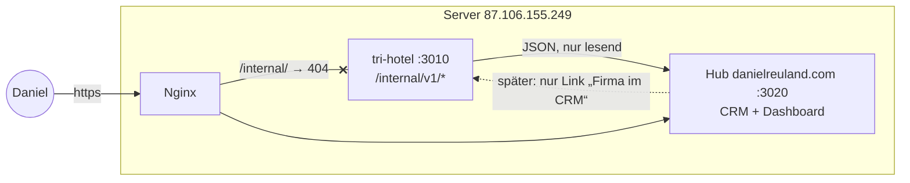

# Konzept: Interne API (tri-hotel) und CRM im Hub danielreuland.com

Stand 02.11.2026 · **Freigegeben (Entscheidungen siehe Schritt 0).** Baut auf `docs/admin-aufteilung.md` (Grundregel: Firmen, Kontakte,
Geschäftsbeziehungen gehören in den Hub) und `docs/internal-api.md` (Vertrag v1, Entwurf 29.10.) auf. Nach Freigabe werden
der API-Vertrag und der Start-Prompt des Hubs (`docs/prompts/hub-start.md`) daran angepasst.

---

## 1. Ziel und Abgrenzung

**Ziel:** Daniel pflegt an *einer* Stelle alle Unternehmen (Hotels, Camp-Anbieter, Reiseanbieter, Partneragenturen …) und ihre
Ansprechpartner – vor allem als **potenzielle Partner-Leads für tri-hotel** (und später fitnessracing-hotel.de, triprep).
Das CRM kennt die tri-hotel-Daten (Score, Live-Status, Aufrufe, Klicks) über die interne API, ohne sie zu kopieren.

| | gehört in … |
|---|---|
| Hotels, Fakten, Score, Camps-Profile, Partnerlinks, Klickzählung, Anfragen an Hotels | **tri-hotel** (wie bisher) |
| Unternehmen, Kontakte, Lead-/Partnerstatus, Aktivitäten, später Verträge und Rechnungen | **Hub** (danielreuland.com/admin) |
| Austausch | **interne API** – tri-hotel bietet an, der Hub liest; v1 nur lesend |

**Neutralität (nicht verhandelbar):** Informationen fließen nur von tri-hotel → Hub. Nichts aus dem CRM (Lead-, Partner-,
Vertragsstatus) erreicht Score, Reihenfolge, Faktenprüfung oder Anfragen von tri-hotel. Die Bestätigung von Fakten durch ein
Hotel (Vertrauensstufe 1) bleibt kostenlos und unabhängig von jeder Geschäftsbeziehung; das gilt auch für Gespräche mit Leads.



---

## 2. Interne API in tri-hotel (Anbieter-Seite)

### 2.1 Grundsätze
- **Nur lesend** in v1, **versioniert** (`/internal/v1`), abwärtskompatible Erweiterungen; Brüche → `/internal/v2`.
- **Nur intern erreichbar** (drei Schichten):
  1. Nginx: `location /internal/ { return 404; }` in *allen* Server-Blöcken der App (tri-hotel.de, www, künftig
     fitnessracing-hotel.de als Site).
  2. App: Anfrage muss von Loopback kommen (`req.socket.remoteAddress` ∈ 127.0.0.1/::1) und darf **kein** `X-Forwarded-For`
     tragen (sonst kam sie über Nginx) – unabhängig von `trust proxy`.
  3. HMAC-Signatur je aufrufender App (unten).
- **Vor der Sitzungs-Middleware** eingehängt: keine Cookies, keine Sitzung, kein CSRF, `Cache-Control: no-store`,
  `X-Robots-Tag: noindex`.
- **Datensparsam:** keine Daten von *Nutzern* der Seite (Melder, Bewerter, Anfragende, Camp-Leads, Antwortende bei
  Hotel-Anfragen). Erlaubt sind **geschäftliche Kontaktdaten von Unternehmen**, die tri-hotel selbst mit Quelle gespeichert hat
  (Hotel-E-Mail von der Hotelwebsite, Telefon/E-Mail der Camp-Anbieter) – nur zur Vorbefüllung im CRM, mit Quelle.
- **Site-bewusst:** tri-hotel ist Multi-Site; Antworten nennen je Objekt alle Rankings/Sites, `stats` liefert je Site.

### 2.2 Authentifizierung (wie im Vertrag v1, ergänzt)
- Geheimnis je App, ≥ 32 Byte zufällig, nur in den Server-`.env`: tri-hotel `INTERNAL_API_KEYS=hub:<geheimnis>`;
  **Schlüsselwechsel** ohne Ausfall: mehrere Einträge je App erlaubt (`hub:<neu>,hub:<alt>`), alter wird nach Umstellung
  entfernt. Daniel trägt Schlüssel selbst ein (`read -s`), nie im Chat/Repo.
- Header `X-Internal-App`, `X-Internal-Timestamp`, `X-Internal-Signature` =
  `hex(HMAC-SHA256(geheimnis, "${ts}\n${METHOD}\n${pfad_mit_query}\n${hex(sha256(body))}"))`.
- Zeitfenster ± 300 s, zeitkonstanter Vergleich. Wiederholung innerhalb des Fensters ist bei nur lesenden Aufrufen
  hinnehmbar; sobald schreibende Endpunkte kommen (v2), zusätzlich Nonce (`X-Internal-Nonce`, 10 min gemerkt).
- Rate-Limit je App (z. B. 120 Aufrufe/min), Antwort 429.
- **Protokoll** jedes Aufrufs in Tabelle `internal_api_calls` (Zeit, App, Methode, Pfad ohne Query-Werte mit
  Personenbezug, Status, Dauer) – ohne Signatur; Aufbewahrung 90 Tage (täglicher Aufräum-Job).

### 2.3 Endpunkte v1 (Erweiterung des Entwurfs vom 29.10.)

| Endpunkt | Zweck im CRM | neu? |
|---|---|---|
| `GET /internal/v1/entities?q=&limit=` | Hotel suchen (Name/Ort, ≥ 2 Zeichen) zum Verknüpfen | – |
| `GET /internal/v1/entities?ids=a,b,c` | Stapelabruf (≤ 100) zum Auffrischen der Anzeige-Caches | **neu** |
| `GET /internal/v1/entities/:id` | Hotelkarte im CRM; **ergänzt** um `address` (aus Grunddaten, falls vorhanden), `contact.email` + `contact.source`, `region` | erweitert |
| `GET /internal/v1/entities/:id/metrics?days=30` | Lead-Argumente: Seitenaufrufe der Hotelseite (Plausible, gecacht), Partner-Klicks je Programm, Status der Faktenanfrage (gesendet/beantwortet, ohne Personendaten), Profil-Vollständigkeit | **neu** |
| `GET /internal/v1/camp-providers?q=` / `?ids=` / `/:id` | Camp-Anbieter verknüpfen; **ergänzt** um `contact.email`, `contact.phone`, `contact.source`, `leadActive` | erweitert |
| `GET /internal/v1/camp-providers/:id/metrics?days=30` | Profilaufrufe, Klicks „Zum Anbieter“, Anzahl Camp-Anfragen je Monat (nur Zahlen – Grundlage für spätere Lead-Abrechnung) | **neu** |
| `GET /internal/v1/partner-programs` | Partnerprogramme (CHECK24, Expedia, Awin-Programme …) als Firmen verknüpfen: Code, Name, Status, mit/ohne Provision, Linkabdeckung, Klicks 7/30 | **neu** |
| `GET /internal/v1/stats` | Hub-Dashboard je Site (wie Entwurf) | – |

Beispiel `entities/:id` (Auszug, neue Felder fett im Vertrag):
```json
{ "id": "uuid", "name": "Club La Santa", "city": "Tinajo", "country": "ES", "type": "hotel",
  "website": "https://www.clublasanta.com", "address": "Av. Krönner 25, 35560 Tinajo, Las Palmas, Spanien",
  "region": { "slug": "lanzarote", "name": "Lanzarote" },
  "contact": { "email": "info@…", "source": "website", "evidence": "https://…/kontakt" },
  "rankings": [ { "code": "triathlon-hotel", "site": "tri-hotel.de", "status": "live", "score": 90,
                  "url": "https://tri-hotel.de/hotel/club-la-santa-tinajo" } ],
  "updatedAt": "2026-11-02T08:00:00Z" }
```

Beispiel `entities/:id/metrics`:
```json
{ "id": "uuid", "days": 30, "pageviews": 41, "visitors": 33,
  "partnerClicks": [ { "program": "check24", "clicks": 2 } ],
  "inquiry": { "status": "answered", "sentAt": "2026-10-20", "answeredAt": "2026-10-22" },
  "completeness": 0.86, "generatedAt": "…" }
```

### 2.4 Umsetzung in tri-hotel (Code)
- `src/lib/internal-auth.js` – reine Funktionen: Signatur bauen/prüfen, Schlüssel-Parser, Zeitfenster (Unit-Tests).
- `src/routes/internal.js` – Router, Loopback-/Header-Wächter, Rate-Limit, Protokoll; in `server.js` vor Sitzung/CSRF.
- `src/services/internal-api.js` – Abfragen (wiederverwendet `dashboard`, `partners.stats`, `analytics`); Plausible-Zahlen je
  Seite mit Cache (z. B. 6 h), damit das CRM Plausible nicht bei jedem Aufruf belastet.
- Migration `internal_api_calls` + Aufräum-Job (pg-boss, täglich).
- **Vertragstests:** Beispielantworten als Dateien `docs/internal-api/fixtures/*.json`; tri-hotel-Tests prüfen, dass echte
  Antworten diese Form haben; der Hub nutzt dieselben Dateien als Mocks.
- `scripts/internal-api-call.js` – signierter Testaufruf auf dem Server (für Daniel/Fehlersuche).

### 2.5 Später (nicht v1)
- **Hub → tri-hotel-Admin:** Link „Firma im CRM“ auf der Objekt- bzw. Camp-Anbieter-Seite (tri-hotel ruft am Hub
  `GET /internal/v1/links?app=tri-hotel&kind=entity&id=…` – liefert nur URL + Firmenname, **nie** einen Status).
- Ereignisse per Webhook an den Hub (Hotel live, neue Camp-Anfrage, Faktenanfrage beantwortet) → Aktivität im CRM.
- triprep: eigener Vertrag (Nutzersuche nur per exakter E-Mail, minimale Felder).

---

## 3. CRM im Hub

### 3.1 Fachliche Regeln
1. Ein **Unternehmen** hat beliebig viele **Kontakte**. Ein Kontakt gehört **immer genau einem** Unternehmen
   (*Änderung gegenüber 29.10.: „höchstens einer“*). Einzelpersonen (z. B. Trainer als Camp-Anbieter, Blogger) werden als
   Unternehmen der Art „Einzelperson/Freiberufler“ mit sich selbst als Kontakt angelegt.
2. **Firmenwechsel** eines Kontakts: Kontakt wird dem neuen Unternehmen zugeordnet, die alte Zugehörigkeit bleibt in der
   Historie sichtbar („bis 03/2027 bei Barceló“). Wer ausscheidet, bekommt den Status „ausgeschieden“ statt gelöscht zu werden
   (bis zur Löschfrist).
3. Ein Unternehmen kann **mehrere Arten** haben (Club La Santa ist Hotel *und* Camp-Anbieter). Die Arten pflegt Daniel im Admin
   (keine feste Liste im Code).
4. **Konzernstruktur:** optional übergeordnetes Unternehmen (Barceló Hotel Group → Barceló Lanzarote Active Resort). Kontakte
   können auf Konzern- *oder* Hotelebene hängen (Vertrieb Zentrale vs. Direktor vor Ort).
5. Ein Unternehmen kann mit mehreren tri-hotel-Objekten verknüpft sein (Kette mit mehreren Hotels); **jedes tri-hotel-Objekt
   hängt an höchstens einem Unternehmen** (Eindeutigkeit über App + Art + externe ID).
6. **Lead- und Partnerstatus gilt je Projekt** (tri-hotel, fitnessracing-hotel, triprep): ein Hotel kann bei tri-hotel
   Partner und bei fitnessracing-hotel noch Lead sein.

### 3.2 Unternehmen – Felder

| Gruppe | Feld | Hinweis |
|---|---|---|
| Stamm | **Name** (Anzeigename) · rechtlicher Name/Firmierung · Rechtsform | rechtlicher Name/Rechtsform erst für Verträge/Rechnungen nötig, optional |
| | **Art(en)** | Mehrfachauswahl, Startliste siehe 3.4 |
| | übergeordnetes Unternehmen | optional (Konzern/Kette) |
| Anschrift | **Straße + Nr.** · Adresszusatz · **PLZ** · **Ort** · Region/Provinz · **Land** (ISO-2) | Rechnungsanschrift abweichend erst mit Rechnungen (Schritt 4) |
| Kommunikation | **E-Mail** (allgemein, z. B. info@) · **Telefon** (international, E.164) · Website · LinkedIn-Unternehmensseite | Telefon wird geprüft und einheitlich gespeichert (+34 928 …) |
| Sprache | Korrespondenzsprache (de/en/es/it/pt …) | wichtig für Ansprache spanischer/italienischer Hotels |
| Herkunft | Quelle (tri-hotel-Objekt, Website, Messe, Empfehlung, LinkedIn, eingehende Anfrage …) · angelegt am/von | Pflicht – Grundlage für Datenschutz (siehe 3.6) |
| Verknüpfungen | tri-hotel-Hotels · Camp-Anbieter · Partnerprogramme (über interne API) | Anzeige mit Score, Status, Aufrufen, Klicks (live aus der API, Cache) |
| Steuer/Abrechnung (später) | USt-IdNr. · Rechnungs-E-Mail · Zahlungsziel | erst mit Rechnungen; jetzt nur Felder vorsehen, nicht bauen |
| Sonstiges | Schlagworte (frei) · Notizen · Status (aktiv/inaktiv/archiviert) | |

### 3.3 Kontakte – Felder

| Gruppe | Feld | Hinweis |
|---|---|---|
| Person | Anrede (Herr/Frau/neutral) · Titel · **Vorname** · **Nachname** | Anrede „neutral“ für geschlechtsneutrale Ansprache |
| Rolle | **Funktion/Position** (Freitext, z. B. „Sales Manager DACH“) · **Rolle im Entscheidungsprozess** (Entscheider · Ansprechpartner fachlich · Einkauf/Marketing · Assistenz · unbekannt) · Abteilung | Rollen-Liste im Admin pflegbar |
| | Hauptansprechpartner (ja/nein) | je Unternehmen ein Hauptkontakt |
| Kommunikation | **E-Mail** · **Telefon** · **Mobil** · **LinkedIn-Profil** (nur `linkedin.com/in/…`) · bevorzugter Kanal · Sprache | E-Mail eindeutig über alle Kontakte (Dublettenschutz) |
| Anschrift | standardmäßig die des Unternehmens; eigene nur, wenn abweichend (z. B. anderer Standort) | Datensparsamkeit |
| Status | aktiv · ausgeschieden · **nicht kontaktieren** | „nicht kontaktieren“ sperrt Kontaktaktionen sichtbar |
| Herkunft & Recht | **Quelle** + Datum (wie Unternehmen) · Rechtsgrundlage (Standard: berechtigtes Interesse, Art. 6 Abs. 1 f DSGVO) · **informiert nach Art. 14 am** · **Werbe-Erlaubnis je Kanal** (E-Mail: Einwilligung ja/nein + Datum + Nachweis; Telefon: mutmaßliches Interesse ja/nein + Begründung) · Widerspruch am | siehe 3.6 |
| Verlauf | letzter Kontakt · nächste Wiedervorlage | aus Aktivitäten (Schritt 2) berechnet |
| triprep | Verknüpfung mit triprep-Nutzer (später, minimale Daten) | |
| Sonstiges | Notizen · Schlagworte | keine sensiblen Daten (Gesundheit, Privates) in Notizen |

**Bewusst nicht aufgenommen:** Geburtstag, Privatadresse, Foto, Familienstand, Hobbys (Datensparsamkeit; für Geschäftskontakte
nicht erforderlich). LinkedIn-Daten nur von Hand übernehmen – kein automatisches Auslesen (Nutzungsbedingungen von LinkedIn).

### 3.4 Arten von Unternehmen (Startliste, im Admin änderbar)
Hotel · Hotelgruppe/-kette · Camp-Anbieter · Reiseveranstalter/Reiseanbieter · Buchungsportal/Partnerprogramm (CHECK24, Expedia,
trivago …) · Affiliate-Netzwerk/Partneragentur (Awin, CJ, TradeTracker, Sovrn …) · Tourismusverband/Destination · Verein/Verband
(Triathlon-Vereine als Zielgruppe für Vereins-Trainingslager) · Sportmarke/Ausrüster · Medien/Blog/Podcast (Backlinks,
Kooperationen) · Dienstleister (Hosting, Mail, Steuerberatung) · Einzelperson/Freiberufler · Sonstiges.

### 3.5 Leads und Beziehungen je Projekt
Tabelle „Beziehung“ = Unternehmen × Projekt:

| Feld | Werte |
|---|---|
| Rolle | Lead · Partner · Kunde · Lieferant · Kooperation (Medien) |
| **Status (Pipeline)** | identifiziert → qualifiziert → kontaktiert → im Gespräch → Angebot → **Partner** · daneben: pausiert · kein Interesse (mit Grund) · nicht geeignet |
| Interesse/Produkt | Mehrfachauswahl, im Admin pflegbar, z. B. Camp-Leads (Weiterleitung je Anfrage) · gekennzeichnete Anzeige/Hervorhebung („Anzeige“) · Direktbuchungslink mit Provision · Hotelfotos mit Nutzungsrecht · Faktenbestätigung (kostenlos!) · Medienkooperation |
| Potenzial | A/B/C (manuell) – Hilfe dazu aus der API: Score, Live-Status, Aufrufe/Klicks 30 Tage, Camp-Anfragen |
| zuständig | Daniel (später Rollen) |
| nächster Schritt + Datum | Wiedervorlage |
| Notizen | |

Liste **„Leads“**: alle Beziehungen eines Projekts mit Filtern (Status, Art, Land/Region, Potenzial, ohne Kontakt seit X Tagen,
Wiedervorlage fällig) und Sortierung. Ein Lead ohne Kontakt mit Status „nicht kontaktieren“ wird markiert.

**Hinweis Neutralität im Vertrieb:** Angebote an Hotels dürfen nie Score, Platzierung im neutralen Ranking oder Prüfergebnis
versprechen. Vorschlag: feste Textbausteine im CRM („Der TriScore ist unabhängig von jeder Partnerschaft …“) und ein Hinweis
in der Lead-Ansicht.

### 3.6 Datenschutz und Wettbewerbsrecht (bitte vor der ersten Ansprache prüfen lassen – keine Rechtsberatung)
- **Rechtsgrundlage:** Geschäftskontakte im B2B-Kontext in der Regel berechtigtes Interesse (Art. 6 Abs. 1 f DSGVO);
  Interessenabwägung einmal dokumentieren (Verzeichnis von Verarbeitungstätigkeiten).
- **Informationspflicht (Art. 14 DSGVO):** Daten, die nicht von der Person selbst stammen (Website, LinkedIn, Empfehlung),
  → Information spätestens bei der ersten Kontaktaufnahme bzw. binnen eines Monats. Feld „informiert am“ + Textbaustein mit
  Link auf die Datenschutzerklärung von danielreuland.com (dort Abschnitt „Geschäftskontakte und CRM“ ergänzen).
- **Werbung per E-Mail (§ 7 UWG):** Werbe-E-Mails brauchen auch gegenüber Unternehmen grundsätzlich eine **vorherige
  ausdrückliche Einwilligung** (Ausnahme: Bestandskunden unter engen Voraussetzungen). Telefonische Ansprache von Unternehmen ist
  bei **mutmaßlicher Einwilligung** (konkreter Bezug zum Geschäft) möglich. In Spanien (LSSI) gelten für kommerzielle E-Mails
  ebenfalls strenge Regeln. → Das CRM speichert die Erlaubnis je Kanal mit Nachweis und warnt, bevor eine Werbe-E-Mail
  vorbereitet wird. Faktenanfragen von tri-hotel bleiben reine Faktenprüfung und werden **nicht** als Vertriebskanal genutzt.
- **Zweckbindung:** Personen, die tri-hotel-Anfragen beantwortet haben (`inquiries.reply_name`), Melder und Camp-Leads werden
  **nicht automatisch** ins CRM übernommen. Übernahme eines Ansprechpartners nur von Hand, mit Quelle, und nur, wenn die
  Datenschutzerklärung von tri-hotel das abdeckt (eigener Schritt, rechtlich prüfen).
- **Widerspruch (Art. 21):** Status „nicht kontaktieren“ + Datum; bleibt als Sperrvermerk mit minimalen Daten erhalten, damit
  die Person nicht erneut angelegt und angeschrieben wird.
- **Auskunft (Art. 15):** Export je Kontakt (alle Felder, Quelle, Verknüpfungen, Aktivitäten, Änderungsprotokoll) als Datei.
- **Löschung (Art. 17) und Fristen:** Kontakt löschen = Datensatz entfernen, Protokolleinträge anonymisieren. Prüfliste:
  Leads ohne Aktivität seit 24 Monaten, ausgeschiedene Kontakte nach 12 Monaten. Geschäftsbriefe/Verträge/Rechnungen haben
  später gesetzliche Aufbewahrungsfristen (6 bzw. 10 Jahre) – betrifft erst Schritt 3/4.
- **Zugriff:** nur Daniel; **Zwei-Faktor-Anmeldung (TOTP)** für den Hub-Admin, weil hier viele Personendaten liegen. Sitzung
  läuft nach Inaktivität ab. Datenbank im täglichen Server-Backup (bereits vorhanden).
- **Änderungsprotokoll:** jede Änderung mit Zeit, wer, Feld, alt/neu (bei Löschung anonymisiert).

### 3.7 Datenmodell (Vorschlag für den Hub)
```
company_types        (id, label, sort_order, active)
contact_roles        (id, label, sort_order, active)
interest_options     (id, label, sort_order, active)          -- Produkte/Interessen für Leads
projects             (id, code, name, domain)                  -- tri-hotel, fitnessracing-hotel, triprep
companies            (id, name, legal_name, legal_form, parent_id → companies,
                      street, address_extra, postal_code, city, region, country,
                      email, phone, website, linkedin_url, language,
                      source, source_detail, status, tags text[], notes,
                      created_at/by, updated_at/by)
company_type_links   (company_id, type_id)                     -- PK beides
contacts             (id, company_id NOT NULL → companies, salutation, title, first_name, last_name,
                      position, role_id, department, is_primary,
                      email UNIQUE (lower), phone, mobile, linkedin_url, preferred_channel, language,
                      own_address jsonb NULL, status (active|left|do_not_contact),
                      source, source_detail, legal_basis, art14_informed_at,
                      email_consent (none|granted|revoked), email_consent_at, email_consent_proof,
                      phone_permission (none|presumed|granted), phone_permission_note,
                      objection_at, tags, notes, created_at/by, updated_at/by)
contact_history      (contact_id, company_id, from, to)        -- Firmenwechsel
company_links        (company_id, app, kind (entity|camp_provider|partner_program), external_id,
                      display_name, cached_at; UNIQUE (app, kind, external_id))
contact_links        (contact_id, app = 'triprep', kind = 'user', external_id; UNIQUE)
relationships        (id, company_id, project_id, role, status, lost_reason, potential (A|B|C),
                      next_step, next_step_at, owner, notes, created_at, updated_at; UNIQUE (company_id, project_id, role))
relationship_interests (relationship_id, interest_id)
activities  [Schritt 2] (id, company_id, contact_id NULL, relationship_id NULL, kind (call|email|meeting|note|linkedin),
                      direction (in|out), occurred_at, subject, summary, outcome, created_by)
audit_log            (id, at, user_id, table, row_id, action, changes jsonb)
admin_users          (id, email, password_hash, totp_secret, …)
```
Prüfungen in der Anwendung: Land ISO-2, Telefon E.164 (Bibliothek `libphonenumber-js`), URLs nur https, LinkedIn-Muster,
Dublettenwarnung (gleiche E-Mail, gleiche Website-Domain, ähnlicher Name im selben Ort).

### 3.8 Oberfläche (Hub-Admin)
- **Unternehmen:** Liste mit Suche (Name, Ort, E-Mail, Domain) und Filtern (Art, Land, Status, Projekt-Status, Schlagwort);
  Detailseite mit Stammdaten, Kontakten, Verknüpfungen (tri-hotel-Karte: Score, Status, Aufrufe/Klicks 30 Tage, Link zur
  Hotelseite und zum tri-hotel-Admin), Beziehungen je Projekt, Verlauf (Schritt 2), Änderungsprotokoll.
- **„Unternehmen aus tri-hotel anlegen“:** Hotel/Camp-Anbieter/Partnerprogramm suchen → Felder vorbefüllt (Name, Ort, Land,
  Anschrift, Website, allgemeine E-Mail/Telefon mit Quelle) → prüfen → speichern + verknüpfen. Optional Sammelaktion für alle
  Live-Hotels (53) und aktiven Camp-Anbieter, jeweils mit Beziehung „Lead · identifiziert“ für tri-hotel.
- **Kontakte:** nur innerhalb eines Unternehmens anlegen; eigene Liste mit Suche; Kontaktseite mit Erlaubnissen/Sperren gut
  sichtbar; Aktionen „Auskunft exportieren“, „Firma wechseln“, „löschen“.
- **Leads:** Liste je Projekt (3.5), später Kanban nach Status.
- **Dashboard:** Kennzahlen je Projekt (`/stats`) + CRM-Zahlen (Leads je Status, fällige Wiedervorlagen).

---

## 4. Schritte und Aufgaben

Größen: S ≈ bis ½ Tag, M ≈ 1 Tag, L ≈ 2–3 Tage (Claude-Arbeitszeit, ohne Wartezeiten).

### Schritt 0 – Entscheidungen (Daniel)
**Entschieden am 02.11.2026:** E1 ja (Kontakt immer genau einem Unternehmen) · E2 ja (Arten als Mehrfachauswahl, mit
Konzernstruktur) · E3 ja (Pipeline wie in 3.5) · E4 ja (TOTP) · E5 ja (Sammelanlage aller Live-Hotels und aktiven Camp-Anbieter
als „identifiziert“, nur Firmendaten) · E6 Datenschutz-Generator + eigene Prüfung durch Daniel · E7 offen (später).
**Ergänzung aus „Hotel-Ansprache neu“ (D5, 02.11.):** Die erste Ausbaustufe enthält zusätzlich den Weg **tri-hotel → Hub** als
signierte Ereignisse (`inquiry.sent`, `inquiry.answered`, `contact.profile`, `contact.consent` mit Einwilligungsnachweis und
Double-Opt-in, `photos.permission`), über eine Warteschlange mit Wiederholung, im Hub idempotent per Ereignis-ID, mit Nonce gegen
Wiederholung. Damit gelten zwei Festlegungen oben nicht mehr unverändert: (1) die interne API ist nicht mehr nur lesend
(schreibender Endpunkt am Hub, z. B. `POST /internal/v1/events`), (2) Ansprechpartner aus Antworten kommen ins CRM, wenn das
Antwortformular und die Datenschutzerklärung das ankündigen (Profil-Kontakt: berechtigtes Interesse; Vertriebskontakt: nur mit
Einwilligung). Konzept: https://claude.ai/artifact/EmRgGEgm2TMm9vSfkvvpqj, Mail-Entwurf `docs/anfrage-mail-entwurf.md`.

- **E1** Kontakt *immer genau einem* Unternehmen zugeordnet (Änderung zu 29.10.) – Einzelpersonen als Unternehmen „Einzelperson“.
- **E2** Arten als Mehrfachauswahl, Startliste 3.4; Konzernstruktur (übergeordnetes Unternehmen) ja/nein.
- **E3** Lead-Status je Projekt und Pipeline-Stufen wie in 3.5.
- **E4** Zwei-Faktor-Anmeldung im Hub ja.
- **E5** Sammelanlage aller Live-Hotels und Camp-Anbieter als Leads ja/nein (oder nur bei Bedarf einzeln).
- **E6** Rechtliche Prüfung der Ansprache (E-Mail-Werbung B2B, Art.-14-Text) vor der ersten Kampagne – wer?
- **E7** Lead-Konditionen der Camp-Anbieter (`lead_fee`, `lead_commission` heute in tri-hotel) später in den Hub (Verträge)?

### Schritt 1 – Interne API v1 (tri-hotel-Repo, diese Sitzung)
| Nr. | Aufgabe | Größe | hängt ab von |
|---|---|---|---|
| A1 | Vertrag `docs/internal-api.md` auf v1-final bringen (Endpunkte 2.3, Felder, Fehler, Rate-Limit, Schlüsselwechsel) + Beispiel-Dateien `docs/internal-api/fixtures/` | S | Freigabe |
| A2 | `src/lib/internal-auth.js` (Signatur, Zeitfenster, Schlüssel-Parser) mit Unit-Tests | S | A1 |
| A3 | Router `/internal/v1` vor Sitzung: Loopback-/Forwarded-Wächter, Rate-Limit, `no-store`; Migration `internal_api_calls` + Aufräum-Job | M | A2 |
| A4 | `entities` (Suche, `ids`, Detail mit Adresse/Kontakt/Region) + Tests | M | A3 |
| A5 | `camp-providers` (Suche, `ids`, Detail mit Kontakt) + Tests | S | A3 |
| A6 | `partner-programs` + Tests | S | A3 |
| A7 | `metrics` für Hotels und Camp-Anbieter (Plausible je Seite mit Cache, Klicks, Anfrage-Status, Camp-Anfragen je Monat) + Tests | M | A4, A5 |
| A8 | `stats` je Site + Tests | S | A3 |
| A9 | Vertragstests gegen die Fixtures; `scripts/internal-api-call.js` | S | A4–A8 |
| A10 | Server: Schlüssel erzeugen (Daniel mit `read -s`), Nginx `location /internal/ { return 404; }` in allen tri-hotel-Blöcken, Probeaufruf von außen (404) und innen (200) | S | A9, „veröffentlichen“ |

### Schritt 2 – CRM Grundlagen (Hub-Repo, eigene Sitzung)
| Nr. | Aufgabe | Größe |
|---|---|---|
| H1 | Repo-Grundgerüst laut `docs/prompts/hub-start.md` (Login, `/healthz`, Startseite, Impressum/Datenschutz) – Prompt vorher an dieses Konzept anpassen | L |
| H2 | Migrationen Datenmodell 3.7 (ohne `activities`), Startlisten Arten/Rollen/Interessen/Projekte | M |
| H3 | Zwei-Faktor-Anmeldung (TOTP) + Sitzungsablauf | M |
| H4 | Unternehmen: Liste, Suche, Filter, anlegen/bearbeiten, Arten, Konzern, Prüfungen, Dublettenwarnung, Änderungsprotokoll | L |
| H5 | Kontakte: anlegen nur unter Unternehmen, bearbeiten, Firmenwechsel mit Historie, Status, Erlaubnisse/Sperren je Kanal | L |
| H6 | Datenschutz-Funktionen: Auskunftsexport, Löschen mit Anonymisierung, Prüfliste Löschfristen, Art.-14-Textbaustein | M |
| H7 | API-Client (HMAC, Timeout 3 s, Fehlertoleranz, Cache) gegen die Fixtures; Verknüpfen Unternehmen ↔ Hotel/Camp-Anbieter/Partnerprogramm | M |
| H8 | „Unternehmen aus tri-hotel anlegen“ (Vorbefüllung) + optionale Sammelaktion (E5) | M |
| H9 | tri-hotel-Karte auf der Unternehmensseite (Score, Status, `metrics`) + nächtliches Auffrischen der Namen (`ids`) | S |
| H10 | Beziehungen je Projekt + Leads-Liste mit Filtern | M |
| H11 | Hub-Dashboard: `/stats` aller Projekte + Lead-Zahlen | S |
| H12 | Datenschutzerklärung danielreuland.com (Geschäftskontakte/CRM), Verzeichnis von Verarbeitungstätigkeiten (Daniel prüft) | S |
| H13 | Deployment (PM2 `danielreuland-com`, Port 3020, DB `danielreuland`, Nginx auf Proxy umstellen) – nach „veröffentlichen“ | M |

### Schritt 3 – Vertriebsarbeit (Hub)
- **V1** Aktivitäten/Verlauf je Unternehmen und Kontakt (Anruf, E-Mail, Treffen, Notiz, LinkedIn), „letzter Kontakt“ automatisch.
- **V2** Wiedervorlagen mit Liste „heute fällig“ (+ optional Mail-Erinnerung morgens).
- **V3** Textbausteine (Erstansprache je Sprache mit Art.-14-Hinweis und Neutralitätssatz), Warnung bei fehlender E-Mail-Erlaubnis.
- **V4** Kanban-Ansicht der Pipeline; CSV-Import (z. B. Messekontakte) mit Dublettenprüfung.
- **V5** tri-hotel → Hub Ereignisse (Webhook) als Aktivitäten; Link „Firma im CRM“ im tri-hotel-Admin (nur Link).

### Schritt 4 – Verträge, Konditionen, Rechnungen (Hub, später)
Angebote/Verträge je Beziehung, Konditionen (Lead-Preis, Provision), Rechnungen für Camp-Leads (Zahlen aus
`camp-providers/:id/metrics`), Partnerprogramm-Auszahlungen; Rechnungsanschrift, USt-IdNr., Aufbewahrungsfristen.
Voraussetzung: Gewerbeanmeldung (BACKLOG).

---

## 5. Risiken und offene Punkte
- **Zwei Sitzungen, ein Vertrag:** Änderungen an der API nur über `docs/internal-api.md` + Fixtures; der Hub baut gegen die
  Fixtures, bis tri-hotel live ist.
- **Plausible je Seite:** Zahlen sind klein (gut 200 Aufrufe/Woche gesamt) – als Verkaufsargument erst ab mehr Reichweite
  belastbar; Anzeige im CRM mit Zeitraum und Quelle.
- **Kontaktdaten aus tri-hotel:** nur Unternehmensadressen (info@, Rezeption, Camp-Anbieter-Kontakt). Enthält ein Feld
  erkennbar eine Personen-Adresse (vorname.nachname@), übernimmt das CRM sie als Unternehmens-E-Mail nur nach Bestätigung.
- **Ausfall tri-hotel:** CRM bleibt nutzbar (Cache-Namen, Hinweis „tri-hotel nicht erreichbar“).
